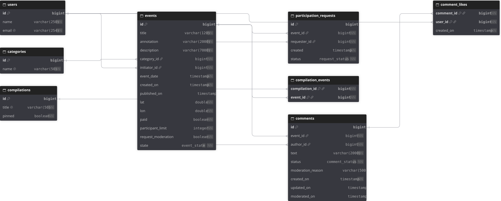

# ER-диаграмма базы данных:
<p align="center">
  
</p>
База данных нормализована к третьей нормальной форме (3NF), 
что обеспечивает минимизацию избыточности данных и улучшает целостность данных.

# Дополнительная фича: комментарии

## Возможности комментариев
- Комментарии к неопубликованным событиям запрещены (только в статусе PUBLISHED)
- Для создания комментария к событию в другом статусе возвращайте 409 (как и для заявок на участие). Если события нет вообще, возвращайте 404.

### Редактирование комментариев
- Автор может изменять свой комментарий в любое время после публикации.
- Редактировать комментарий может только его автор.
- после правки статус возвращается в PENDING и требуется одобрение администратором

### Модерация комментариев
- Администратор должен одобрять или отклонять комментарии пользователей.
- причина отклонения обязательна

### Реакции (likes)
- Автор может ставить лайк собственному комментарию
- Один лайк на пользователя, с возможностью снять

## Эндпоинты фичи

| Метод | Путь | Доступ | Назначение |
|---|---|---|---|
| `POST` | `/users/{userId}/comments` | Private | Создать комментарий к опубликованному событию |
| `GET` | `/users/{userId}/comments` | Private | Комментарии пользователя во всех статусах |
| `PATCH` | `/users/{userId}/comments/{commentId}` | Private | Изменить свой комментарий (снова `PENDING`) |
| `DELETE` | `/users/{userId}/comments/{commentId}` | Private | Удалить свой комментарий |
| `POST` | `/users/{userId}/comments/{commentId}/likes` | Private | Поставить лайк одобренному комментарию |
| `DELETE` | `/users/{userId}/comments/{commentId}/likes` | Private | Снять лайк |
| `GET` | `/events/{eventId}/comments` | Public | Одобренные комментарии события (`from`, `size`) |
| `GET` | `/admin/comments` | Admin | Очередь модерации (`status`, `from`, `size`) |
| `PATCH` | `/admin/comments/{commentId}` | Admin | Одобрить (`APPROVED`) или отклонить (`REJECTED` + причина) |
| `DELETE` | `/admin/comments/{commentId}` | Admin | Удалить комментарий |

Жизненный цикл: `PENDING` → `APPROVED` | `REJECTED`, правка автором возвращает комментарий в `PENDING`.
Публично отдаются только `APPROVED`, лайкать можно только `APPROVED`.

## Postman: проверка фичи

Коллекция — `postman/feature.json`. Она самодостаточна: создаёт пользователей, категорию и событие,
публикует событие, проходит все сценарии фичи и удаляет за собой данные, поэтому прогон можно повторять.

```bash
docker compose up -d
newman run postman/feature.json --env-var baseUrl=http://localhost:8080
```
